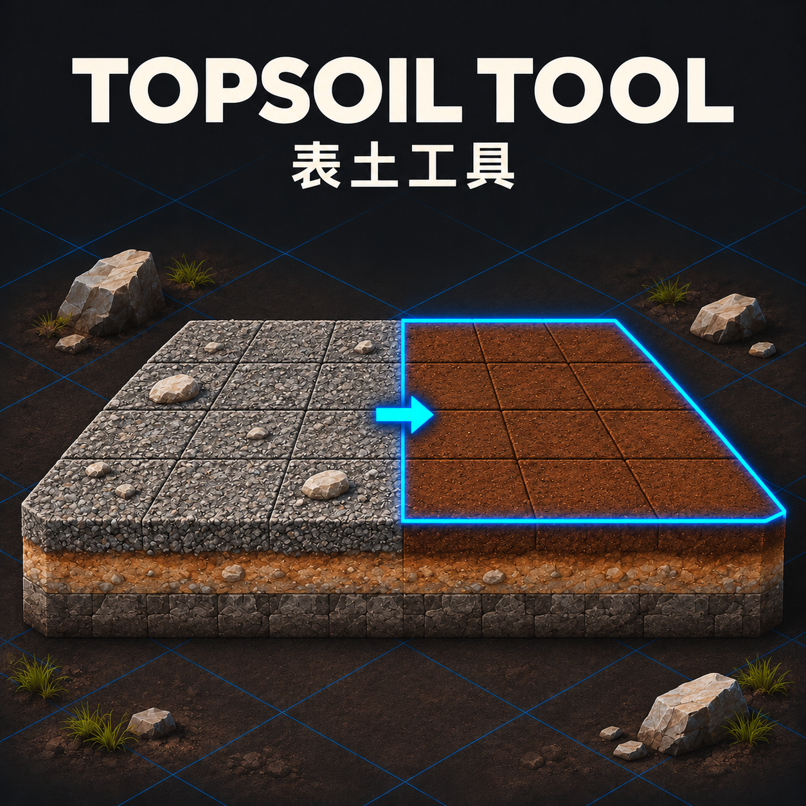

# Topsoil Tool · 表土工具



Press Shift+T to select flat terrain in 4×4 blocks. Replace the top layer with dirt at the same elevation and clear decorative rocks in one step.

按 Shift+T 框选 4×4 规划格，将平地表层换成土，保留原标高，同时清理装饰石头。

Captain of Industry Update 4.3 · 针对 0.8.8d 编译。

## 安装与使用

- 将 `TopsoilTool` 文件夹放入 `%APPDATA%\Captain of Industry\Mods\`，在存档的模组列表中启用。
- 按 `Shift+T` 打开。蓝色预览显示格子和当前高度。左键单击处理一个 4×4 格，拖框可选多格，松开执行，右键或 `Esc` 取消。
- 深蓝色格子会跳过换土。格内有坡面、海域、铺面或建筑时，整格跳过换土。
- 确认时清理选区内的原版装饰石头，包括已经是土的地块。保存后换土和清理结果会随存档保留。

## 编译

用 .NET SDK 6 或更高版本，指定游戏的 `Captain of Industry_Data\Managed` 文件夹。

```powershell
dotnet build -c Release -p:CaptainIndustryManagedPath="D:\SteamLibrary\steamapps\common\Captain of Industry\Captain of Industry_Data\Managed"
```

成品在 `bin\Release\TopsoilTool\`。采用 [MIT 许可证](LICENSE)。
